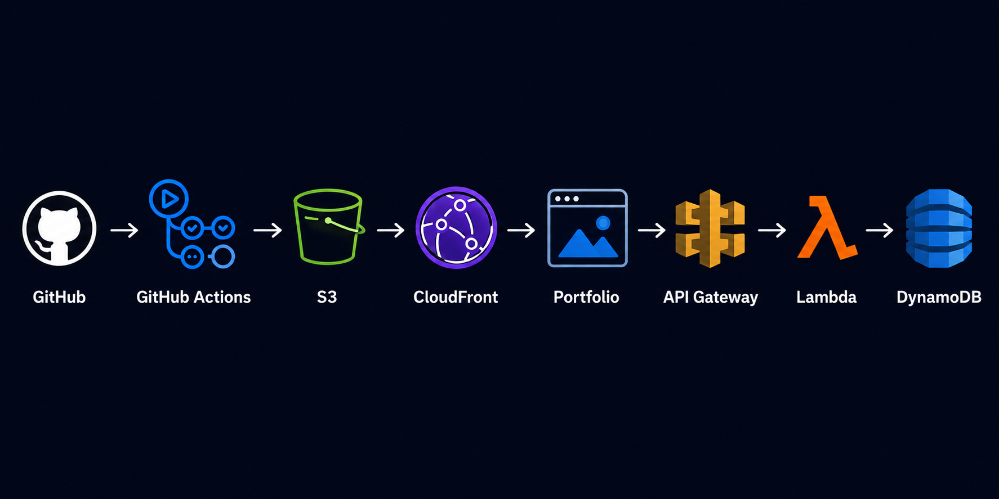

# Christian Lemma - Portfolio

A serverless personal portfolio hostd on AWS with automated CI/CD deployment through GitHub Actions.


## 🌐 Live Website

[View Portfolio](https://d3u8c6bjwc5l68.cloudfront.net/)


## Architecture


GitHub

↓

GitHub Actions

↓

Amazon S3

↓

Amazon CloudFront

↓

Portfolio Website

↓

API Gateway

↓

AWS Lambda

↓

Amazon DynamoDB


## 🏗️ Architecture Overview

- **GitHub** - Source control and project management.
- **GitHub Actions** - Automatically deploys changes whenever code is pushed to the 'main' branch.
- **Amazon S3** - Stores and serves the portfolio's static assets.
- **Amazon CloudFront** - Provides HTTPS. CDN delivery, and secure access to the S3 origin.
- **Origin Access Control (OAC)** - Prevents direct public access to the S3 bucket while allowing CloudFront to retrieve objects.
- **Amazon API Gateway** - Provides the HTTP endpoint for the visitor counter.
- **AWS Lambda** - Serverless backend that retrieves and updates the visitor count.
- **Amazon DynamoDB** - Stores the portfolio visitor count.
- **IAM** - Controls access between AWS services using least-privilege permission.


## 🚀 Features

- Responsive personal portfolio
- AWS cloud Hosting
- HTTPS through CloudFront
- Automated CI/CD deployment
- Serverless visitor counter
- DynamoDB-backed visitor tracking
- Least-privilege IAM permissions
- GitHub-based source control


## 🛠️ Technologies

### Frontend
- HTTPS
- CSS
- JavaScript

### Cloud
- Amazon S3
- Amazon CloudFront
- AWS Lambda
- Amazon API Gateway
- Amazon DynamoDB
- AWS IAM

### DevOps

- Git
- GitHub
- GitHub Actions
- AWS CLI


## 🔄 CI/CD Pipeline

Changes are deployed automatically through GitHub Actions.

1. Code is pushed to the `main` branch.
2. GitHub Action starts the deployment workflow.
3. AWS credentials are configured securely through GitHub Secrets.
4. Website files are synchronized to the S3 bucket.
5. CloudFront cache is invalidated.
6. The updated portfolio becomes available through CloudFront.

This allows deployments to be performed with a single:

```bash
git push
```

## 🔐 Security

The S3 bucket is protected from direct public access through CloudFront Origin Access Control.

The Lambda execution role follows the principle of least priviledge and only has the DynamoDB permissions required for the visitor counter:

- **dynamodb:GetItem**
- **dynamodb:UpdateItem**

The Lambda role also uses ***AWSLambdaBasicExecutionRole*** for CloudWatch logging.

AWS credentials used by GitHub Actions are stored as GitHub repository secrets rather than committed to the repository.


## 📁 Project Structure

    cloud-portfolio/
    |
    |──── .github/
    |        └── workflows/
    |            └── deploy.yml   
    |
    |──── assets/
    |    
    |        └── images/
    |            └── cloud_pic.png
    |            └── favicon.png
    |    
    |──── css/
    |      └── style.css
    |    
    |──── js/
    |      └── script.js
    |    
    |──── index.html
    |──── README.md
    |──── .gitignore


## Author

### Christian Lemma
Computer Science graduate